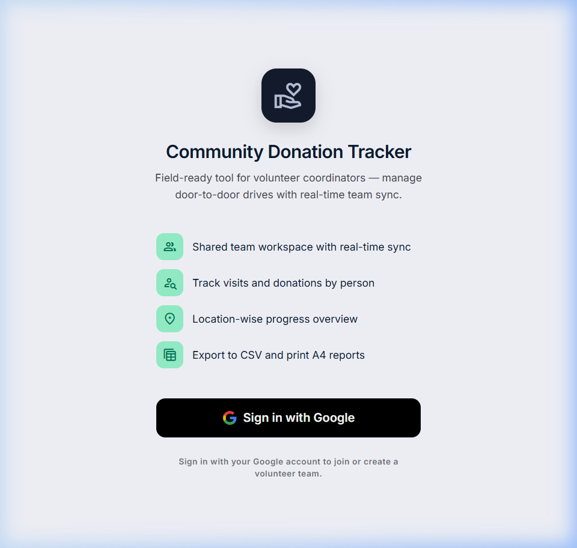
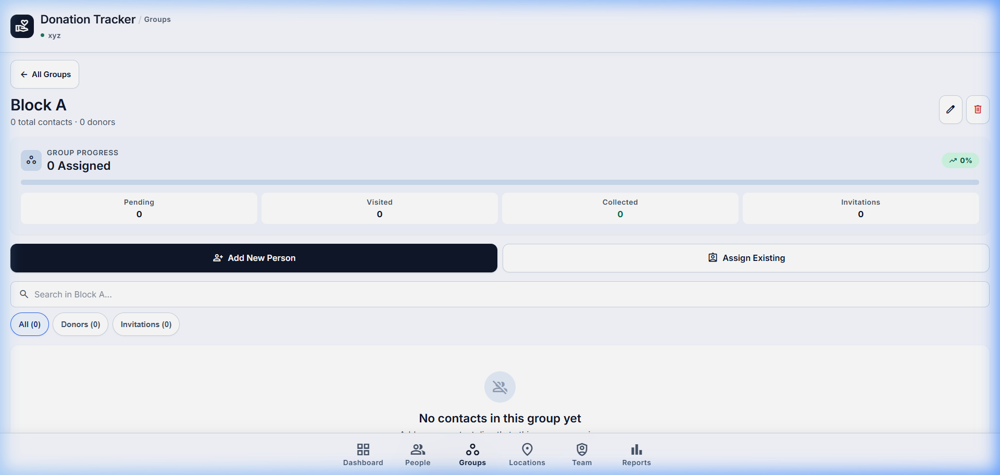
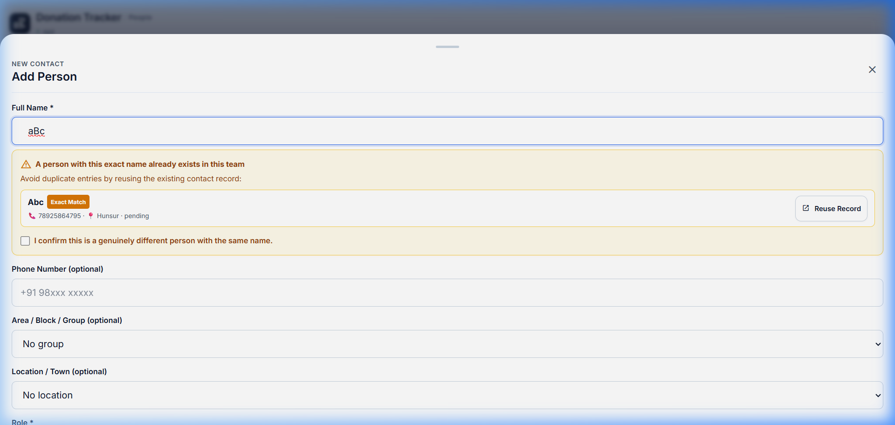
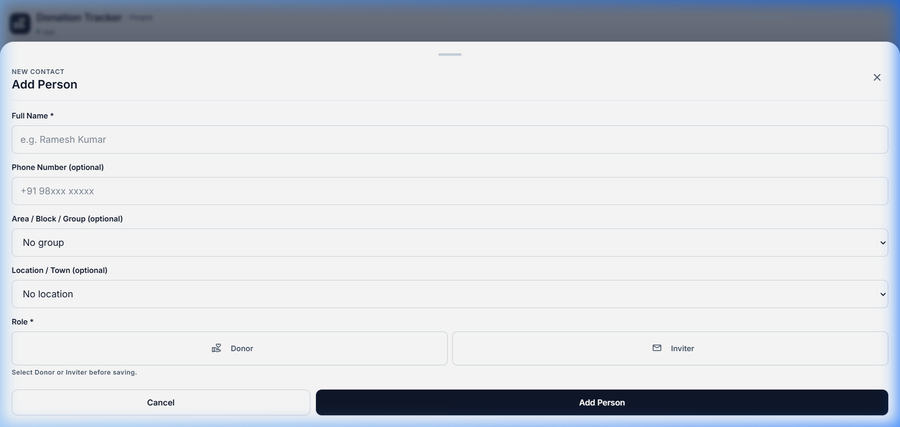
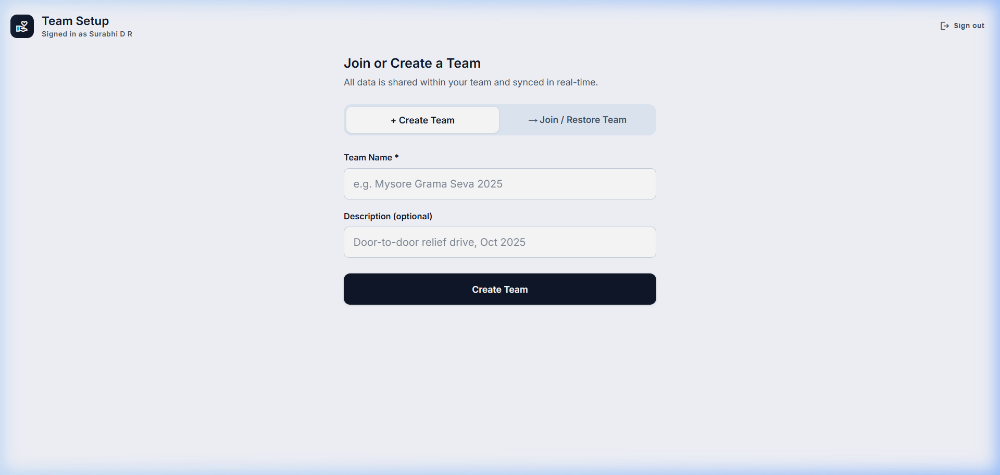

# Community Donation Tracker

A modern, responsive web application designed for community organizers and field volunteer teams to coordinate donation campaigns, manage outreach contacts, and track collection progress in real time.

Built with **React 19**, **TypeScript**, **Vite**, and **Firebase (Authentication & Cloud Firestore)**, featuring high-contrast UI design, team-scoped access control, duplicate person detection, and group organization.

---

## 🎯 Problem It Solves

Community fundraising drives and neighborhood outreach efforts frequently suffer from operational challenges:
- **Disorganized spreadsheets** leading to duplicate visits and outreach overlaps.
- **Ambiguous contact roles** where volunteers confuse donation pledges with event invitation lists.
- **Lack of team coordination** across field volunteers working concurrently in different blocks or neighborhoods.
- **Loss of state & connectivity issues** during active on-ground volunteer workflows.

The **Community Donation Tracker** solves these problems with a unified, real-time platform featuring team-isolated workspaces, smart duplicate warnings, dedicated groups, independent donor/inviter workflows, and one-click reporting.

---

## ✨ Key Features

- **💰 Donation Amount Tracking in Indian Rupees (INR, ₹)**:
  - Input validation enforcing positive numeric monetary amounts, rejecting negative values, zero, malformed text, or currency symbols.
  - Indian numbering formatting (`₹1,500` or `₹15,000.00`) via `Intl.NumberFormat('en-IN')`.
  - Multiple contribution support per person without silently overwriting earlier donations (maintains stable contribution ID, amount in INR, recorded date/time, recorder UID/name, and optional notes).
  - Honest legacy handling: collected records without an amount are transparently identified as "Amount not recorded" rather than misrepresented as ₹0.
- **📈 Total Amount Collected KPI & Summaries**:
  - Prominent emerald hero card on the Dashboard displaying team-scoped collection totals, donor counts, and missing-amount notices.
  - Dynamic progress and collection breakdowns by Group and Location.
  - Strict exclusion of inviter-only contacts from monetary collection calculations.
- **🔄 Seamless Invitation-to-Donor Conversion**:
  - One-click "Mark as Donor" / "Record Donation" directly from invitation lists and drawers.
  - Updates the canonical person record in-place without generating duplicate contacts.
  - Preserves original invitation role, guest attendance status, and group assignments.
- **🔐 Google Authentication**: Secure sign-in via Firebase Authentication with automatic session and team membership persistence across reloads.
- **👥 Team Isolation & Joining**: Create isolated team workspaces or join existing teams via secure 12-character invite codes. Multi-team switching is built-in.
- **🏢 Dedicated Groups Management**:
  - Organize community contacts into custom groups (e.g., *Block A*, *Block B*, *Local Residents*, *Friends*).
  - Dedicated Groups landing page with an empty state and group creation dialog.
  - Drill down into group details with group-specific KPI summaries, collection totals, and completion bars.
  - Assign existing unassigned contacts or add new contacts directly to a group.
  - Safe group deletion that unassigns contacts without ever deleting person records.
- **🔍 Smart Duplicate Detection**:
  - Live as-you-type autocomplete and similarity warnings.
  - Matches transposed names (e.g. "John Doe" vs "Doe John") and case/whitespace variations.
  - Non-blocking amber notice that warns volunteers without halting submission when distinct individuals share names.
  - Excludes the current contact from triggering false positives when editing.
- **📋 Independent Donor & Inviter Workflows**:
  - Clear separation between donor pledge collection and event invitation statuses.
  - Both roles start unselected on new contact creation with validation preventing unclassified entries.
  - Quick status updates (Pending, Visited, Collected) directly from contact cards or drawers.
- **📍 Locations & Groups as Independent Dimensions**:
  - Physical locations (streets, buildings) remain separate from social/organizational groups.
- **📊 Real-Time Dashboard & Analytics**:
  - Live metrics for total contacts, pending visits, donations collected, and invitations delivered.
  - Progress breakdowns by location and group.
- **📤 Export & Reporting**:
  - **CSV Export**: Includes donation amounts in INR, summary total row, and UTF-8 BOM encoding for Microsoft Excel.
  - **A4 Print / PDF**: Formatted print sheets with repeated headers, collection summaries, and coordinator sign-off blocks.

---

## 📸 Screenshots

| Dashboard & Real-Time KPIs | Dedicated Group Detail View |
| :---: | :---: |
|  |  |

| Smart Duplicate Detection | Add / Edit Person Form |
| :---: | :---: |
|  |  |

| Team Setup & Join Workspace |
| :---: |
|  |

---

## 🛠️ Technology Stack

| Layer | Technology | Details |
| :--- | :--- | :--- |
| **Frontend Framework** | React 19 (`^19.3.1`) | Functional components, hooks, custom context providers |
| **Language** | TypeScript (`~6.0.3`) | Strict type checking, shared domain models |
| **Build Tool & Dev Server**| Vite 8 (`^8.3.5`) | Fast HMR, optimized production asset bundling |
| **Backend & Database** | Google Cloud Firestore | Real-time snapshots (`onSnapshot`), subcollections |
| **Authentication** | Firebase Authentication | Google OAuth provider, token lifecycle |
| **Styling** | Vanilla CSS & Design Tokens | Accessible, high-contrast, Stitch-inspired UI |
| **Linter** | Oxlint (`^1.88.0`) | High-performance static code analysis |
| **Testing** | Node.js Test Runner | Native strip-types testing (`node --test`), 39 automated tests |
| **Hosting & Deployment** | Vercel | Production edge CDN, SPA rewrites, automated deployments |

---

## 🏗️ Architecture & Data Model

### Architecture Overview

```mermaid
graph TD
    User([Field Volunteer]) -->|Google Auth| AuthCtx[AuthContext]
    AuthCtx --> TeamCtx[TeamContext]
    
    subgraph UI Components
        Dashboard[DashboardPage & Collections KPI]
        People[PeoplePage & PersonForm]
        Groups[GroupsPage & DetailView]
        Locations[LocationsPage]
        Reports[ReportsPage & CSV Export]
        Modal[RecordDonationModal]
    end

    TeamCtx --> UI Components
    Modal --> TeamCtx
    
    subgraph Google Cloud Firestore
        TeamsCol[(teams)]
        MembersCol[(teams/{teamId}/members)]
        PeopleCol[(teams/{teamId}/people)]
        GroupsCol[(teams/{teamId}/groups)]
        ConfigDoc[(teams/{teamId}/private/config)]
    end

    TeamCtx <-->|Live onSnapshot / Write| TeamsCol
    TeamCtx <-->|Live onSnapshot / Write| MembersCol
    TeamCtx <-->|Live onSnapshot / Write| PeopleCol
    TeamCtx <-->|Live onSnapshot / Write| GroupsCol
    TeamCtx <-->|Read Invite Code| ConfigDoc
```

### Firestore Hierarchy

```text
teams/{teamId}
  ├── name: string
  ├── description: string
  ├── ownerId: string (UID)
  ├── createdAt: Timestamp
  │
  ├── members/{memberUid}
  │     ├── uid: string
  │     ├── displayName: string
  │     ├── email: string
  │     ├── role: 'owner' | 'member'
  │     └── joinedAt: Timestamp
  │
  ├── groups/{groupId}
  │     ├── id: string
  │     ├── name: string
  │     ├── description?: string
  │     ├── createdByUid: string
  │     └── createdAt: Timestamp
  │
  ├── people/{personId}
  │     ├── fullName: string
  │     ├── phone?: string
  │     ├── location?: string
  │     ├── group?: string
  │     ├── isDonor: boolean
  │     ├── isInviter: boolean
  │     ├── status: 'pending' | 'visited' | 'collected'
  │     ├── amount?: number (Numeric INR amount)
  │     ├── contributions?: Array<{
  │     │     id: string,
  │     │     amount: number,
  │     │     date: string,
  │     │     recordedAt: string,
  │     │     recordedByUid?: string,
  │     │     recordedByName?: string,
  │     │     note?: string
  │     │   }>
  │     ├── inviterStatus: 'not_invited' | 'invited' | 'confirmed'
  │     ├── createdByUid: string
  │     └── updatedAt: Timestamp
  │
  └── private/config
        └── inviteCode: string (12-char hex token)
```

---

## 💻 Local Setup & Development

### Prerequisites
- **Node.js**: v20+ or v22+
- **npm**: v10+

### 1. Clone Repository & Install Dependencies
```bash
git clone https://github.com/surabhi-04/community-donation-tracker.git
cd community-donation-tracker
npm install
```

### 2. Environment Variables Configuration
Copy `.env.example` to create your local `.env.local` configuration:
```bash
# On Windows PowerShell
Copy-Item .env.example .env.local

# On macOS / Linux
cp .env.example .env.local
```

Fill in your Firebase credentials in `.env.local`:
```env
VITE_FIREBASE_API_KEY=AIzaSy...
VITE_FIREBASE_AUTH_DOMAIN=your-project-id.firebaseapp.com
VITE_FIREBASE_PROJECT_ID=studio-9799450408-69c06
VITE_FIREBASE_STORAGE_BUCKET=your-project-id.firebasestorage.app
VITE_FIREBASE_MESSAGING_SENDER_ID=123456789012
VITE_FIREBASE_APP_ID=1:123456789012:web:abcdef...
```

> 🔒 **Security Notice**: `.env.local` is listed in `.gitignore` and must **never** be committed to version control.

### 3. Run Development Server
```bash
# Windows / PowerShell
npm.cmd run dev

# macOS / Linux
npm run dev
```
Open [http://localhost:5173](http://localhost:5173) in your browser.

---

## 🧪 Testing, Linting & Building

The project includes 39 automated tests covering team persistence, duplicate matching, groups workflow, and donation tracking:

```bash
# Run automated test suites
npm test

# Run Oxlint static analysis
npm run lint

# Compile TypeScript and generate production bundle
npm run build

# Preview production build locally
npm run preview
```

---

## 🛡️ Security Architecture & Honest Assessment

Donation amounts and community member records are sensitive information. Here is the verified security model implemented in this project:

### 1. Existing Protections (Active)
- **Transport Security (HTTPS / TLS 1.3)**: All traffic between users, Vercel edge infrastructure, and Google Firebase endpoints is strictly encrypted in transit using HTTPS and TLS.
- **Authentication Required**: All team data, contacts, and donation entries require an authenticated Google user session. Unauthenticated access is denied.
- **Team-Level Data Isolation**: Application state and database queries are strictly scoped to the active team (`teams/{teamId}/people`, `teams/{teamId}/groups`). Cross-team reads and writes are prevented.
- **Input Validation**: Strict monetary validation ensures only finite positive numeric values (<= 1,000,000,000) are accepted. Malformed strings, negative numbers, and injection attempts are blocked.
- **No Private Secrets in Frontend**: Only public Firebase client configuration parameters are bundled. No Google Cloud service account keys, private API secrets, or administrative tokens exist in client source code.
- **Production Console Sanitization**: Sensitive identifiers, phone numbers, and raw database payloads are not dumped to browser developer tools logs in production.
- **Client-Side CSV Safeguard**: CSV exports format telephone numbers as text cells (`="\t+91..."`) to eliminate Excel formula injection (CSV Injection / DDE).

### 2. Honest Analysis of End-to-End Encryption (E2EE)
- **Current Reality**: The application currently relies on **Transport Layer Security (TLS)** in transit and **Google Cloud managed encryption at rest**. It **DOES NOT** provide genuine client-side End-to-End Encryption (E2EE). In the current architecture, data resides in plaintext in Cloud Firestore, meaning database administrators with Google Cloud Console access could read collection amounts and donor records.
- **Why Superficial "E2EE" Was Rejected**: Storing a symmetric key in frontend `.env` files, hardcoding an encryption passphrase, or storing the encryption key beside encrypted documents in Firestore is "security theater" and provides zero real cryptographic protection.
- **Proposed Architecture for True E2EE**:
  1. **Key Generation**: Each user generates an asymmetric key pair (e.g., via the Web Crypto API using RSA-OAEP or ECDH / X25519) on their local device.
  2. **Team Symmetric Key (DEK)**: When a team is created, a 256-bit AES-GCM Data Encryption Key (DEK) is generated locally.
  3. **Key Exchange (KEM)**: The team DEK is wrapped individually with the public keys of approved team members and stored in `teams/{teamId}/keys/{memberUid}`.
  4. **Client-Side Encryption**: Field volunteers encrypt contact details and donation amounts in their browser before writing to Firestore, and decrypt them locally upon reading.
  5. **Searchable Encryption**: To maintain name search and duplicate detection across encrypted records, blind indexing or cryptographic hashing (HMAC with a team search key) would be required.
- **Firestore Rule Preservation Notice**: Production Firestore security rules for this Firebase project are shared with **RepoRefine**. In accordance with change management procedures, rules were not modified or redeployed without explicit cross-project review.

---

## 🚀 Deployment to Vercel

Production URL: [https://community-donation-tracker.vercel.app](https://community-donation-tracker.vercel.app)

Configured for automatic continuous deployment from GitHub branch `main` with SPA client-side routing.

---

## 📄 License

This repository is maintained as a portfolio project. All rights reserved.
